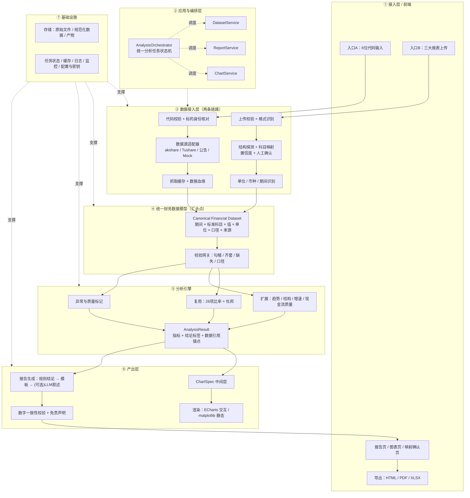

# 财务分析系统 · 架构介绍（设计阶段）

> **文档状态**：架构设计稿 v0.1 · 2026-11-19 · **本阶段只做架构分析与选型，不含任何实现代码**
> **适用工程**：`finance-starter`（现有 Python 财会数据分析项目）
> **一句话定位**：把现有「命令行脚本集」演进为「双入口 → 统一财务数据模型 → 分析引擎 → 文字报告 + 数据分析图」的可服务化系统。

---

## 0. 本文定位与边界

| 项 | 说明 |
|---|---|
| 本次交付 | 本文档（架构分析、选型对比、风险与落地路线） |
| 本次不做 | 编码、建表、装依赖、改现有脚本 |
| 设计原则 | **演进式改造**，最大化复用现有 `src/` 分析内核，不推倒重来 |
| 后续动作 | 按第 2 / 18 节覆盖默认假设后，依第 16 节 Phase 路线分阶段实施 |

系统目标功能（来自需求）：

1. **入口 A**：输入 6 位 A 股代码 → 生成该公司的财务分析报告 + 各类数据分析图；
2. **入口 B**：上传三大报表（资产负债表 / 利润表 / 现金流量表）→ 生成对应财务分析报告 + 各类数据分析图。

**明确不做的范围**（防止范围蔓延）：实时行情、投资建议与买卖判断、自动交易、估值定价/目标价、同业对标（列为 Phase 4+ 可选扩展）。

---

## 1. 需求拆解

### 1.1 两条入口的差异与共性

| 维度 | 入口 A：股票代码 | 入口 B：上传三表 |
|---|---|---|
| 输入 | 6 位数字代码（+ 可选期数、是否强制刷新） | 3 个文件（xlsx / csv / pdf，可能还有扫描件） |
| 数据来源 | 外部公开财报接口（需联网、可能限流） | 用户本地文件（可能非上市、非标准科目、单位不一） |
| 特有难点 | 标的身份核对、接口稳定性、缓存新鲜度、报告期对齐 | 表格结构探测、科目名称映射、单位/币种/期间识别、三表齐套与勾稽 |
| 数据可信度 | 取决于数据源，需标注来源与时点 | 取决于用户文件，需标注「用户上传」并做质量报告 |
| 共同产出 | **同构的**：结构化指标结果 + 文字报告 + 图表集合 | 同左 |

> **核心判断**：两条链路的输入形态差异极大，但下游（分析、报告、图表）完全相同。因此架构的关键不是"写两套"，而是**让两条链路在「统一财务数据模型」处汇合**，下游只实现一次。

### 1.2 非功能需求（按优先级）

1. **数字准确与可追溯**：报告/图表中的每个数字必须能回溯到「来源 + 报告期 + 科目口径」；不得由模型或模板凭空生成。
2. **口径正确**：合并报表 vs 母公司、归母净利润 vs 净利润、同比 vs 环比、期末值 vs 平均余额、财年 vs 自然年不得混淆。
3. **缺失显式化**：科目缺失、接口失败、期间不足时明确标注缺口，禁止补零或插值伪造。
4. **可扩展**：数据源、文件格式、图表、报告格式均可插拔。
5. **安全**：上传文件校验、路径隔离、资源限流；prod 环境密钥与数据隔离。
6. **性能与体验**：单次分析在可接受时间内完成；进度可查询；重复请求走缓存。

---

## 2. 约束清单与默认假设

> 架构设计需先明确目标与约束。以下业务约束尚未提供，本稿按「默认假设」给出完整方案；实际约束与假设不同时，按最后一列的调整方向覆盖即可。**这些假设是待覆盖项，不是既定事实。**

| 约束 | 默认假设（本稿据此设计） | 若不同，架构如何调整 |
|---|---|---|
| 使用人群 | 个人 / 小团队内部使用，非公开对外服务 | 对外服务需增加账号体系、权限、审计、限流、计费与合规评估 |
| 访问规模 | 日均 < 100 次分析，峰值并发 < 5 | 高并发需异步任务队列、多副本、数据库与对象存储、连接池 |
| 部署环境 | dev 本机；prod 单机 Docker Compose | K8s / 多机需拆分 worker、共享存储、集中日志与配置中心 |
| 联网与数据源预算 | 可联网，先用免费源（akshare），预算为 0 | 付费源（Wind / 同花顺 / Tushare Pro 高积分）需加授权管理、配额与成本控制 |
| 报告交付格式 | HTML（含交互图）为主，PDF / Excel 导出 | 若强制 Word，需引入文档生成通道并放弃交互图或改静态图 |
| 是否需要 LLM 写叙述 | 可选、后置（先做确定性模板报告） | 若必须，需增加密钥管理、超时回退、数字一致性校验与脱敏 |
| 上传文件格式范围 | xlsx / csv 优先，pdf 次之，扫描件 OCR 暂不支持 | 支持扫描件需引入 OCR 服务与人工复核环节，复杂度显著上升 |
| 数据留存 | 保留原始文件与分析产物，可随时删除 | 严格不留痕需改为内存处理 + 短 TTL + 加密存储 |

---

## 3. 现有工程盘点与差距

### 3.1 可复用资产（读自现有代码与 README）

| 现有模块 | 已有能力 | 目标系统中的位置 | 改造点 |
|---|---|---|---|
| `src/io_utils.py` | `load_statement` / `item` / `load_all` / `check_balance_identity` / `check_cash_ties`；统一「报告日 × 科目」宽表；行业科目归一；缺失补 NaN | 数据接入层的**归一化 + 勾稽校验**内核 | 拆为 `normalize` 与 `validation` 两个职责；输入输出改为标准数据模型而非固定路径 |
| `src/ratios.py` | 6 大类 26 项指标 + 杜邦分解（`solvency`/`profitability`/`operation`/`growth`/`cashflow`/`dupont`/`summary`） | **分析引擎核心**，几乎可原样迁入 | 增加指标元数据（口径、单位、依赖科目、可解释标签）与数据引用锚点 |
| `src/visualize.py` | `setup_chinese_font` / `plot_trend` / `plot_radar`，自动挑中文字体 | **静态图渲染通道**（PDF/PNG 导出） | 输出改为由 ChartSpec 驱动；线程安全与字体打包 |
| `src/reports.py` | `build_report` 生成 11 个 sheet 的 Excel 报告 | **Excel 导出器** | 从「主报告」降级为「导出格式之一」；文字叙述独立成报告服务 |
| `scripts/fetch_akshare.py` | 用 akshare 新浪接口拉三表，落 `data/raw/{code}_*.csv` | **A 股数据源适配器的第一个实现** | 抽出接口、加超时/重试/缓存/多源回退；代码前缀规则需扩展（见 6.1） |
| `scripts/run_*_analysis.py` | 命令行编排：加载 → 比率 → 图 → Excel | **编排层的原型参考** | 由脚本 `main()` 升级为可调用的 `AnalysisOrchestrator` 服务 |
| `data/demo`、`data/raw` | 演示数据 + 已拉取的真实数据（结构与真实财报一致） | **端到端测试夹具 / 离线 mock 数据源** | 保留，作为回归基线 |
| `README.md` | 已记录指标口径、单位换算、勾稽口径、行业科目差异等关键约定 | **口径规范的起点** | 抽出为机器可读的「科目词典 + 口径规则表」 |

### 3.2 差距清单（目标系统需要补的能力）

1. 没有统一财务数据模型：现在依赖「固定目录 + 固定文件名 + 固定宽表结构」；
2. 没有输入校验与标的身份核对（6 位代码歧义、退市、非股票代码）；
3. 没有文件上传通道（格式识别、结构探测、科目映射、单位/期间识别、人工确认）；
4. 外部数据源不可插拔：akshare 硬编码在脚本里，无缓存、无重试、无多源回退、无数据血缘；
5. 没有「文字」财务分析报告：现有产物是 Excel 数值表 + 2 张 PNG；
6. 图表数量与种类不足（仅趋势图、雷达图），且与渲染方式耦合；
7. 没有服务化接口、任务状态、进度、错误码、并发与超时控制；
8. 没有产物隔离（现有 `output/` 按代码前缀覆盖）、日志、监控、dev/prod 配置分离。

---

## 4. 架构总览

### 4.1 分层视图



### 4.2 五条架构原则

| 原则 | 含义 | 解决什么问题 |
|---|---|---|
| **单点汇合** | 两条入口都产出同一个 Canonical Dataset，下游零分支 | 避免"两套分析报告、两套图表"的重复实现与口径漂移 |
| **数字与叙述分离** | 数字由分析引擎确定性计算并注入；文字由模板/LLM 生成且不产数 | 杜绝 LLM 编造财务数字，满足可追溯红线 |
| **规格与渲染分离** | 引擎只产出 ChartSpec（数据 + 编码 + 来源元信息），前端/后端各自渲染 | 一套图表定义同时服务交互页与 PDF 导出 |
| **适配器隔离** | 外部数据源、文件格式、LLM 全部通过适配器接口接入 | 免费接口改名/限流、换付费源时不动核心代码 |
| **全程血缘** | 从原始文件/接口响应 → 归一映射 → 指标 → 报告数字，每层带来源与审计信息 | 用户可核对"这个 ROE 从哪来"，也便于故障定位 |

---

## 5. 统一财务数据模型（本系统的地基）

### 5.1 为什么必须先建它

现有代码能跑通，是因为演示数据与 akshare 真实数据被刻意做成**同一种宽表结构**（新浪口径「报告日 × 科目」、单位元）。一旦允许"用户上传任意三表"，这个前提就不成立：科目名不同（「所有者权益合计」vs「股东权益合计」）、单位不同（元/万元/亿元）、期间不同（年报/季报）、单表多期 vs 多表单期、金融业科目体系不同。**没有标准模型，上传链路只能靠无穷无尽的 if-else 打补丁。**

### 5.2 模型定义（逻辑结构，非建表语句）

**Dataset（一次分析的数据集）**

| 字段 | 说明 |
|---|---|
| `dataset_id` | 唯一标识（按 task_id 隔离产物） |
| `origin` | `code`（入口A）/ `upload`（入口B） |
| `subject` | 代码 / 公司名称 / 上传方自定义名称 |
| `source_ref` | 数据源标识 + 接口/文件名 + 获取时间（UTC+8 时间戳） |
| `statement_scope` | `consolidated` 合并 / `parent` 母公司 |
| `currency` / `unit` | 币种、内部统一存储单位（建议「元」原值） |
| `periods` | 报告期列表 |
| `quality` | 质量报告：齐套性、勾稽差异、缺失科目、映射置信度 |

**StatementFact（最小事实粒度，长表）**

| 字段 | 说明 |
|---|---|
| `period_end` / `period_type` | 报告期末日期；`FY` / `H1` / `Q1` / `Q3` / `TTM` |
| `statement_type` | `BS` / `IS` / `CF` |
| `item_key` | **标准科目编码**（引擎唯一认这个） |
| `item_label_raw` | 原始科目名（保留，供审计） |
| `value` | 数值；缺失为 `null`，**不填 0** |
| `unit_raw` / `currency` | 原始单位与币种（换算前留痕） |
| `is_restated` | 是否追溯重述 / 更正后口径 |
| `mapping_confidence` | 科目映射置信度（上传链路专用） |
| `source_ref` | 追溯到原始行/单元格或接口响应 |

> 「标准科目词典」建议分两层：**通用层**（营收、营业成本、净利润、归母净利润、资产总计、负债合计、所有者权益、经营活动现金流净额……）+ **行业扩展层**（银行/保险/证券专用科目）。现有 `io_utils.item()` 里的行业归一逻辑正好迁入词典层，并升级为可配置表而非硬编码分支。

### 5.3 校验网关（进入引擎前的强制关卡）

| 校验 | 级别 | 处理 |
|---|---|---|
| 三表齐套（BS / IS / CF 至少各 1 期） | 阻断 | 缺表直接返回明确错误，不进入分析 |
| `资产总计 = 负债合计 + 所有者权益合计` | 阻断 | 超容差则中止并给出差异明细（沿用现有严格校验） |
| `期末现金 = 货币资金` | 提示 | 真实财报常因受限资金不等，只记录，不中断（README 已注明） |
| 净利润 ↔ 现金流量表起点、现金净增加额勾稽 | 提示 | 记录差异，写入报告「数据质量」章节 |
| 单位 / 币种 / 期间一致性 | 阻断 | 混用单位必须人工确认后才放行 |
| 期间可比性（同为年报、同为合并口径） | 提示/阻断 | 跨口径比较禁止自动进行，须显式声明 |
| 科目缺失 | 提示 | 标记为 null，相关指标不出图、不出结论，报告中列明缺口 |

---

## 6. 两条核心链路

### 6.1 链路 A：输入 6 位 A 股代码

| 步骤 | 处理 | 关键设计 |
|---|---|---|
| 1 | 格式校验：`^\d{6}$` | 只做格式，不等于"是有效股票" |
| 2 | **市场与证券类型判定** | 沪市 `600/601/603/605/688`、深市 `000/001/002/003/300/301`、北交所 `8/4` 段、B 股 `900/200`；明确支持范围并在 UI 说明 |
| 3 | **标的身份核对** | 查标的 master 表：是否 A 股个股、是否退市/暂停上市、是否更名、是否指数/基金/债券代码。**典型坑：`000001` 既是平安银行股票代码，也是上证指数代码**——必须按"代码 + 市场 + 证券类型"三元组确认，不能只凭字符串 |
| 4 | 参数解析 | 期数（近 N 年/季）、报表范围（合并/母公司）、`force_refresh` |
| 5 | 缓存查询 | key = 代码 + 数据源 + 报表类型 + 范围；TTL + 财报发布期触发失效；命中则跳过抓取 |
| 6 | 抓取（适配器） | 统一接口 `fetch_statements(code, scope) -> RawBundle`；akshare 为默认实现，可插拔 Tushare Pro / 交易所公告 / Mock；超时、重试、退避、限流 |
| 7 | 落原始快照 | 原始响应/CSV 原样留档（`RawBundle`），带数据源 + 抓取时间，供复核与重放 |
| 8 | 归一 → Canonical Dataset | 科目映射、单位统一到「元」、报告期解析、**按公告日期/报告期排序（新浪接口按公告时间倒序，取错行会拿到最早年份）** |
| 9 | 汇合 | 进入 5.3 校验网关 → 分析引擎 |

**缓存与"最新数据"的矛盾**：缓存提升体验，但财报刚披露时用户要的是新数据。建议「TTL + 强制刷新按钮 + 按报告期/公告日期失效」三者并存，并在报告页显式打印「数据截止时间」，不把缓存数据表述为实时数据。

### 6.2 链路 B：上传三大报表

| 步骤 | 处理 | 关键设计 |
|---|---|---|
| 1 | 上传校验 | 文件数、大小上限、扩展名白名单、MIME 校验、宏/公式风险提示、随机化存储文件名（禁路径穿越） |
| 2 | 格式识别 | `xlsx/xls` (openpyxl/pandas)、`csv`（编码探测 GBK/UTF-8-BOM）、`pdf`（表格抽取，扫描件需 OCR，Phase 后置） |
| 3 | **表格结构探测** | 识别表头行、期间列（单表多期 / 多表单期）、科目列、单位标注（元/万元/千元/亿元）、合计行、附注行；产出结构描述供确认 |
| 4 | **科目映射** | 别名词典精确匹配 → 归一化文本模糊匹配（去空格/括号/全半角）→ 置信度打分；**高于阈值自动采纳，低于阈值进入人工确认页**（用户把原始科目拖到标准科目上），确认结果可回写词典 |
| 5 | 单位 / 币种 / 期间识别 | 从表头或用户确认获取，换算留痕（`value` 存原值换算后，`unit_raw` 保留原单位）；禁止默认假设"单位是元" |
| 6 | 三表齐套与角色确认 | 用户可能上传顺序错乱或文件名无语义 → 按科目特征自动识别哪张是 BS/IS/CF，并让用户确认 |
| 7 | 勾稽校验 | 5.3 全部规则；失败时返回**可读的差异明细**（哪个期间、差多少、可能是哪张表错位），而不是笼统报错 |
| 8 | 归一 → Canonical Dataset | 与链路 A 输出完全同构 |
| 9 | 汇合 | 同一分析引擎、同一报告模板、同一图表集合 |

> **上传链路的产品关键点**：不要追求"全自动猜对"。财务数据错了比慢一点更糟。设计一个轻量的「映射确认页 + 质量报告」，把不确定的地方交还用户确认，是准确率的决定性环节。

---

## 7. 分析引擎

### 7.1 组成

| 层 | 内容 | 来源 |
|---|---|---|
| 指标计算 | 偿债 6、盈利 5、营运 3、成长 4、现金流 3、杜邦 5（共 26 项） | **复用 `src/ratios.py`**，保持函数签名与口径不变 |
| 趋势与结构 | 多期同比/环比、CAGR、收入成本费用结构占比、资产/负债结构占比 | 新增 |
| 现金流质量 | 净现比、经营现金流/营收、经营 vs 投资 vs 筹资现金流对比、FCF 近似 | 部分复用现金流类指标 |
| 洞察规则 | 阈值 + 趋势组合 → 结论标签（如"毛利率连续 3 期下行""经营现金流与净利润背离"） | 新增，确定性规则 |
| 异常与质量 | 勾稽差异、缺失科目、极端值、除零/负值、可比性警告 | 新增 |

### 7.2 口径红线（必须写进代码注释与报告页）

- **归母净利润 ≠ 净利润**；现有项目用「净利润」口径，若数据源提供归母净利，须在报告中注明所用口径，不得混用。
- **同比 ≠ 环比**；**财年 ≠ 自然年**；年报与季报不得直接混比，跨期比较先对齐 `period_type` 与 `statement_scope`。
- 周转率类指标用**期初期末平均余额**，首年无期初退回期末值（README 已约定）；增速首年为 `NaN` 是正常现象，图表留白不补 0。
- 分母为 0 / 负值 / 缺失时输出 `NaN` 并附原因，不做隐式兜底。
- 所有金额在引擎内部统一为「元」原值，**展示层**才换算亿元/万元；比率无量纲，不受单位影响。

### 7.3 输出契约 `AnalysisResult`

结构化结果包含：指标表（按期间）、每项指标的 `data_ref` 引用锚点（指向 `StatementFact`）、结论标签列表、质量标志列表、数据来源与时点摘要。**报告与图表一律消费这份结果，不重新读原始表**，这是数字一致性的前提。

---

## 8. 报告生成

### 8.1 三层生成流水线

| 层 | 职责 | 是否产数字 |
|---|---|---|
| ① 结构化结论 | 规则引擎基于 `AnalysisResult` 生成结论与数据引用 | **是**（唯一数字来源） |
| ② 模板叙述 | Jinja2 模板把结论 + 数字渲染为章节文字，注入来源/报告期/单位说明 | 只搬运，不产生 |
| ③ LLM 润色（可选） | 仅优化行文、补充解释性描述，**输入中给出白名单数字，输出禁止新增/改写数字** | **否**（硬约束） |

**防幻觉工程措施**：LLM 输出后，用正则抽取全部数值与 `AnalysisResult` 数字白名单比对；出现任何未授权数字即**回退到纯模板版本**并记录告警。同时设置超时、重试上限与关闭开关。

### 8.2 报告章节骨架

1. 30 秒结论（核心指标 + 主要风险，每条带数据引用）
2. 数据说明与口径：来源、抓取/上传时间、报告期、单位、合并/母公司、质量提示、缺失科目清单
3. 盈利能力 / 4. 成长性 / 5. 偿债与资本结构 / 6. 营运效率 / 7. 现金流质量
8. 杜邦分解（分解乘积与直接计算恒等性校验）
9. 异常与风险提示（勾稽差异、口径不可比、数据源分歧）
10. 附录：指标口径表、科目映射表（上传链路）、来源清单

> **合规要求**：每份报告页脚固定输出「本内容基于公开数据/用户上传数据与量化分析，仅供参考，不构成投资建议」及数据来源与数据截止时间；上传数据明确标注「由用户提供，系统未做外部核验」。

### 8.3 交付格式选型

| 格式 | 交互图 | 易生成 | 易分发 | 结论 |
|---|---|---|---|---|
| HTML（研报式） | ✅ ECharts | ✅ | 一般（需在线/打包） | **主交付** |
| PDF | ❌ 静态图 | ✅（HTML 打印 / WeasyPrint） | ✅ | 导出项 |
| Excel | ❌ 数值表 | ✅ **已有 `reports.py`** | ✅ | 导出项（复用现有能力） |
| Word | ❌ 静态图 | 需额外通道 | ✅ | 仅当用户强制要求 |

---

## 9. 可视化设计

### 9.1 ChartSpec 中间层

每张图先生成一份与框架无关的规格：`{chart_id, title, chart_type, series[], axes[], unit, periods[], source_ref, quality_flags[]}`。前端用 ECharts 渲染交互版，后端复用 `src/visualize.py` 渲染静态 PNG 供 PDF/Excel 导出。**同一份规格，两处渲染，数值不会不一致。**

### 9.2 图表清单（"各种数据分析图"的具体落地）

| # | 图表 | 类型 | 数据依赖 | 入口 |
|---|---|---|---|---|
| 1 | 营收 / 净利润 / 经营现金流多期趋势 | 折线 + 柱组合 | IS + CF | A / B |
| 2 | 营收、净利润同比增速 | 分组柱 | 成长类指标 | A / B |
| 3 | 毛利率 / 净利率 / ROE 趋势 | 多线 | 盈利类指标 | A / B |
| 4 | 资产结构（流动/非流动） | 堆叠柱/面积 | BS | A / B |
| 5 | 负债与所有者权益结构 | 堆叠柱 / 环形 | BS | A / B |
| 6 | 收入 → 成本 → 费用 → 利润 瀑布 | 瀑布 | IS | A / B |
| 7 | 经营 / 投资 / 筹资现金流净额对比 | 分组柱 | CF | A / B |
| 8 | 净利润现金含量（净现比） | 折线 + 基准线 | CF + IS | A / B |
| 9 | 五维能力雷达（偿债/盈利/营运/成长/现金流） | 雷达 | **复用现有 `plot_radar`** | A / B |
| 10 | 杜邦分解与 ROE 驱动变化 | 瀑布 / 树图 | 杜邦指标 | A / B |
| 11 | 应收 / 存货 / 总资产周转率趋势 | 多线 | 营运类指标 | A / B |
| 12 | 应收 + 存货占资产比重 | 堆叠面积 | BS | A / B |
| 13 | 数据质量热力图（缺失科目 / 勾稽差异） | 热力 | 质量报告 | B 为主 |
| 14 | 同业对标（可选扩展） | 分组柱 | **需额外数据源** | Phase 4+ |

### 9.3 图表质量规则

- 空值 / NaN **不入图**（增速首年留白），禁止以 0 代替缺失；
- 量级差异大的系列使用双轴并明确标注轴单位，或改用指数化；
- 全图金额单位统一（亿元/万元），标题或图注写明单位与报告期；
- 每张图图注带来源与数据截止时间；上传数据标注「用户上传」；
- 中文标注（服务器需内置 Noto Sans CJK 等中文字体，否则导出变方框）；
- 若未来涉及涨跌类视觉，按 A 股习惯 **涨红跌绿**。

---

## 10. 技术选型对比

> 每项给出推荐与理由；成本按「开发量 / 运维量 / 费用」定性评估。

### 10.1 前端形态

| 方案 | 开发量 | 交互体验 | 可产品化 | 适用 | 结论 |
|---|---|---|---|---|---|
| Streamlit | 极低（复用 Python） | 中 | 低（并发/定制弱） | 内部工具、快速验证 | **Phase 3 过渡可选** |
| React + ECharts + FastAPI | 中 | 高（交互图、映射确认页） | 高 | 目标系统 | **推荐（正式形态）** |
| 纯 CLI + 静态文件 | 极低 | 低 | 低 | 现状 | 不满足"系统"要求 |

### 10.2 后端框架

| 方案 | 异步/文件上传 | 类型校验 | 自动生成接口文档 | 结论 |
|---|---|---|---|---|
| **FastAPI** | 好 | Pydantic 原生，契合 Canonical Model 的 DTO | 自带 | **推荐** |
| Flask | 一般 | 需额外库 | 需扩展 | 轻量备选 |
| Django | 好（但重） | ORM 强 | 需 DRF | 需要完整账号/后台时才值得 |

### 10.3 A 股财务数据源

| 方案 | 成本 | 稳定性 | 覆盖 | 风险 | 结论 |
|---|---|---|---|---|---|
| **akshare（新浪/东财接口）** | 免费 | 低（接口易变、限流） | A 股三表足够 | 字段改名、倒序、限流 | **默认实现（已有）**，必须包在适配器后 |
| Tushare Pro | 积分/付费 | 中高 | 全、口径规范 | 积分门槛、配额 | 第一回退源 |
| 巨潮 / 交易所公告 PDF | 免费 | 中（解析成本高） | 最权威（一手） | 解析与 OCR 复杂 | 校验/兜底与分歧仲裁 |
| Wind / 同花顺等商业库 | 高 | 高 | 全 | 授权与合规 | 企业级才考虑 |

> **决策**：定义 `FinancialSourceAdapter` 接口，默认 akshare，配置化多源回退与分歧仲裁（多源同指标不一致时优先交易所/公告等一手来源，并**显式标注分歧**，不静默取一个）。现有 `fetch_akshare.py` 迁入该接口。

### 10.4 图表渲染

| 方案 | 交互 | 静态导出 | 复用现有代码 | 结论 |
|---|---|---|---|---|
| ECharts（前端） | ✅ | 需后端另出图 | — | Web 主通道 |
| matplotlib（现有） | ❌ | ✅ | ✅ | 静态导出通道，**保留** |
| Plotly | ✅ | ✅ | ❌ | 单栈可替代二者，但会重写现有可视化 |

> 采用 ChartSpec 双通道，避免二选一：**不重写 `visualize.py`，也不放弃交互图**。

### 10.5 任务执行与存储

| 维度 | MVP（dev / 低并发） | prod（规模化） |
|---|---|---|
| 任务执行 | 同步 + 超时 + 进度轮询 | Redis + RQ/Celery 异步 worker |
| 元数据 | SQLite | PostgreSQL |
| 原始文件 / 产物 | 本地 `artifacts/{task_id}/` | 对象存储（MinIO / 云 OSS） |
| 缓存 | 本地文件 + TTL | Redis + 报告期失效策略 |
| 报告叙述 | 纯模板（确定性） | 模板 + 可选 LLM（带回退） |

**推荐 MVP 组合**：FastAPI +（Streamlit 过渡 或 React）+ SQLite + 本地 artifacts + 同步任务 + akshare 适配器 + ChartSpec/ECharts + 模板报告；prod 再按上表升级。

---

## 11. 服务接口设计（契约概要）

| 方法 | 路径 | 用途 |
|---|---|---|
| `POST` | `/api/v1/analysis/by-code` | 入参 `{code, periods, scope, force_refresh}` → 返回 `task_id` |
| `POST` | `/api/v1/analysis/by-upload` | multipart 三表 + 可选单位/期间提示 → 返回 `task_id` |
| `GET` | `/api/v1/tasks/{id}` | 状态、进度、阶段、错误码与可读原因 |
| `GET` | `/api/v1/datasets/{id}/mapping` | 上传链路的科目映射建议与置信度 |
| `PUT` | `/api/v1/datasets/{id}/mapping` | 提交人工确认结果，继续流程 |
| `GET` | `/api/v1/reports/{id}` | HTML 报告；`?format=pdf|xlsx` 导出 |
| `GET` | `/api/v1/charts/{id}` | ChartSpec 列表（含来源与质量标记） |
| `GET` | `/api/v1/health` | 健康检查（含数据源连通性） |

**统一任务状态机**：`CREATED → INGESTING → (WAITING_MAPPING) → VALIDATING → ANALYZING → RENDERING → DONE`，任一阶段可落 `FAILED`（带结构化错误码：代码无效 / 数据源不可用 / 文件解析失败 / 三表不齐 / 勾稽不通过 / 期间不可比）或 `PARTIAL`（带质量提示继续出报告）。

**统一响应**：`{task_id, status, progress, data?, quality?, error?, source_meta?}`；所有产物按 `task_id` 隔离，避免现有 `output/` 按代码前缀相互覆盖的问题。

---

## 12. 目标目录结构（演进建议，非本次实施）

```
finance-starter/
├── src/                       # 【保留/改造】现有分析内核，逐步迁入 app/engine
│   ├── io_utils.py            # → app/domain/normalize + app/engine/validation
│   ├── ratios.py              # → app/engine/ratios（函数签名保持不变）
│   ├── visualize.py           # → app/rendering/static_charts
│   └── reports.py             # → app/reporting/excel_exporter
├── app/                       # 【新增】应用与服务层
│   ├── api/                   # FastAPI 路由、DTO、错误码
│   ├── services/              # AnalysisOrchestrator / Dataset / Report / Chart
│   ├── adapters/              # AShareSource(akshare|tushare|mock) / UploadParser
│   ├── domain/                # CanonicalModel、标准科目词典、口径规则
│   ├── engine/                # 校验网关、指标、趋势结构、洞察规则
│   ├── reporting/             # 模板、LLM 叙述器、数字一致性校验、导出
│   ├── rendering/             # ChartSpec 生成、静态图导出
│   └── storage/               # 仓储、缓存、任务状态
├── web/                       # 【新增】React + ECharts（或 Streamlit 过渡）
├── data/{demo,raw}/           # 【保留】回归夹具 / 离线 mock 数据源
├── artifacts/{task_id}/       # 【新增，替代 output/】产物隔离目录
├── tests/                     # 【新增】口径回归、端到端、一致性校验
├── docs/                      # 本文档
└── deploy/                    # Dockerfile / compose / nginx.conf / .env.example
```

---

## 13. 风险提示与常见坑

### 13.1 数据类

| 坑 | 后果 | 对策 |
|---|---|---|
| akshare / 免费接口改名、限流、返回结构变化 | 入口 A 整体不可用 | 适配器 + 原始快照 + 多源回退 + 数据源健康监控；字段映射配置化 |
| 新浪接口行按**公告时间倒序** | 取末行拿到最早年份 | 按报告期解析后显式排序（README 已提示） |
| 6 位代码歧义（`000001` 指数 vs 个股）、B 股/北交所/退市/更名 | 分析错标的，属硬错误 | 代码 + 市场 + 证券类型三元组核对，标的 master 表 |
| 单位混用（元/万元/千元/亿元）、币种混用 | 指标差几个数量级 | 内部统一存「元」，`unit_raw` 留痕，单位未知时阻断要求确认 |
| 合并报表 vs 母公司、追溯重述/更正公告 | 跨期不可比 | `statement_scope` / `is_restated` 建模，跨口径比较禁止自动进行 |
| 金融业（银行）科目体系不同 | 映射错、指标 NaN | 通用 + 行业扩展双层科目词典（现有归一逻辑迁入） |
| 多数据源同指标数值分歧 | 报告自相矛盾 | 一手来源优先 + 显式标注分歧，不静默选一个 |

### 13.2 财务口径类

归母净利与净利润混淆、同比与环比混淆、财年与自然年混用、期末余额当平均余额、首年增速补 0、分母为 0/负值隐式兜底、年报与季报直接混比、TTM 与年度口径混用 —— 全部落在第 7.2 节红线中，需以**单元测试 + 报告页口径说明**双重保障。

### 13.3 工程类

| 坑 | 对策 |
|---|---|
| 服务器缺中文字体 → 导出图方框 | 镜像内置 Noto Sans CJK，沿用 `setup_chinese_font` 候选列表 |
| matplotlib 非线程安全 → 并发出图串图/崩溃 | 静态渲染放独立进程或加锁，每任务独立 figure |
| pandas 读大 xlsx 内存峰值 / 超大上传 DoS | 体积上限、流式/分块、超时、任务队列隔离 |
| akshare 同步阻塞拖死 API | 适配器调用放线程池或 worker，设置超时与重试上限 |
| NaN 一路传播到图表和文字 | 校验网关显式拦截，图表空值不入图，报告列明缺口 |
| 缓存与"最新数据"矛盾 | TTL + 强制刷新 + 报告期失效 + 报告页打印数据截止时间 |
| 产物相互覆盖 | `artifacts/{task_id}/` 隔离，禁用按代码前缀直接写共享目录 |
| LLM 超时/幻觉/费用失控 | 可选开关、超时回退、数字白名单校验、token 上限、脱敏 |

### 13.4 安全与合规类

- **上传安全**：扩展名 + MIME 白名单、大小上限、禁用宏执行、公式/CSV 注入防护（导出时对以 `= + - @` 开头的单元格转义）、随机化文件名、路径穿越防护、临时文件定期清理。
- **数据合规**：用户上传的报表可能含敏感经营数据 → 明确留存策略、访问隔离、日志脱敏、可删除接口。
- **免责声明**：报告固定输出"不构成投资建议"；系统不做买卖判断与目标价。
- **来源标注**：关键数字附近标注来源 + 时点；二手来源标注"需核实原文"；上传数据标注未外部核验。

---

## 14. dev / prod 环境差异

| 维度 | dev（本地原型） | prod（上线） |
|---|---|---|
| 数据源 | 默认用 `data/raw/` 现有快照做 Mock，避免频繁打免费接口 | 真实适配器 + 多源回退 + 缓存 + 连通性告警 |
| 数据库 / 文件 | SQLite + 本地 `artifacts/` | PostgreSQL + 对象存储 / 挂载卷（含备份） |
| 任务 | 同步执行、详细阶段日志、热重载 | 异步 worker、限流、超时、重试、死信告警 |
| 报告 | 纯模板（无外部依赖，结果可复现） | 模板 + 可选 LLM，密钥走环境变量/secret，不入代码库 |
| 安全 | 本地回环访问、允许调试错误栈 | HTTPS、上传限流、CORS 白名单、错误脱敏、访问日志与审计 |
| 可观测 | 控制台日志 | 结构化日志 + 指标（任务耗时、数据源成功率、映射置信度分布、LLM 回退率）+ 健康检查 |
| 配置 | `.env.local`、明文示例值 | `.env` 由部署注入，密钥轮换，配置与代码分离 |

---

## 15. 部署步骤（prod 概要，待 Phase 5 细化）

1. **镜像**：Python 3.13 基础镜像 + 依赖锁定（`requirements.txt` 升为 `pyproject` 锁文件）+ 中文字体 + 非 root 用户。
2. **编排**：`docker compose` 起 `api` / `worker` / `redis` / `postgres` / `nginx`（对象存储按需）。
3. **配置注入**：数据源凭据、`LLM_API_KEY`、`DATABASE_URL`、缓存 TTL、上传大小上限、日志级别；密钥不入库不入镜像。
4. **反向代理**：Nginx 处理 HTTPS、静态资源、`client_max_body_size`、长任务超时与超时提示。
5. **健康检查与监控**：`/api/v1/health` 含数据源连通性；采集任务耗时/成功率/映射置信度/回退率；错误告警。
6. **数据保障**：数据库与 `artifacts/` 定期备份；镜像 tag 化便于回滚；数据库迁移可回退。
7. **灰度**：先用 `data/demo` 端到端 → 再用 `data/raw` 真实数据只读验证 → 最后开放上传入口。
8. **回滚**：保留上一版镜像与配置；异常时先关闭 LLM 与上传入口，退回模板 + 缓存数据只读模式。

---

## 16. 分阶段实施路线与验收标准

| Phase | 内容 | 验收标准 |
|---|---|---|
| **P0 约束确认** | 本文档 + 第 2/18 节决策拍板 | 使用人群、规模、部署环境、数据源预算、报告格式、LLM 取舍均有明确结论 |
| **P1 数据地基** | Canonical Model、标准科目词典、单位/期间归一、校验网关；用 demo + raw 两种来源跑通归一 | 两条链路产出**完全同构**的 Dataset；勾稽/缺失/单位错误能给出可读明细；现有 26 项指标数值不回归 |
| **P2 引擎与图表规格** | 迁入 `ratios.py`，新增趋势/结构/现金流质量/洞察规则；产出 ChartSpec | 指标回归基线一致；ChartSpec 可序列化且带来源元信息；空值/除零/负值有明确处理 |
| **P3 服务化 + 前端** | FastAPI 接口、任务状态机、上传解析与映射确认页、ECharts 交互页 | 输入 `600519` 出完整报告 + 图；上传 demo 三表出完整报告 + 图；两条链路下游代码零分支 |
| **P4 报告与导出** | 模板报告、数字一致性校验、PDF/Excel 导出、（可选）LLM 叙述与回退 | 报告中所有数字 100% 可溯源；注入一个假数字能被校验拦截并回退；免责声明与来源标注齐全 |
| **P5 部署与加固** | 缓存、多源回退、异步任务、监控、日志、备份、灰度 | prod 冒烟通过；数据源故障与 LLM 超时演练可降级；上传安全用例通过 |

> 每个 Phase 结束都应能**独立演示可运行成果**，而不是等全部做完才第一次跑通。

---

## 17. 测试与验证要点

- **单元**：代码格式/市场/证券类型判定；单位换算；科目映射（含金融业别名词）；26 项指标口径；除零/负值/NaN；期间可比性。
- **集成**：入口 A 用现有 `data/raw` 快照做离线端到端；入口 B 用 `data/demo` 三表 + 故意改列名/改单位/缺一张表的变体做端到端。
- **一致性**（本系统最重要的测试）：报告文本中所有数值 ↔ `AnalysisResult` 白名单比对；ChartSpec 数值 ↔ 指标表比对；杜邦分解乘积 ↔ 直接计算恒等。
- **故障**：接口超时/限流/字段改名、勾稽不通过、上传超大文件/含公式 CSV/扫描件、LLM 超时与幻觉注入。
- **回归基线**：现有 `600519_财务分析报告.xlsx` 与两张 PNG 作为指标数值对照，升级后同口径数值应一致。

---

## 18. 实施前需覆盖的约束项

> 本文已按第 2 节默认假设给出完整架构方案与选型结论；下列约束用于 Phase 1 实施时覆盖默认假设，各项调整方向已在第 2 节表中列出。

1. **使用人群与规模**：内部自用 / 小团队 / 对外公开服务？日均分析与峰值并发量级？→ 决定是否需要账号、权限、异步队列与多副本。
2. **部署环境**：本机 / 单机 Docker / 云服务器 / K8s？操作系统与是否有 GPU（影响是否本地跑 LLM）？
3. **数据源预算**：接受免费源的不稳定，还是愿意采购付费数据/申请 Tushare 积分？→ 决定适配器回退链与缓存策略。
4. **报告主格式**：HTML 交互研报（推荐）/ PDF / Word / 仍以 Excel 为主？是否需要多语言？
5. **叙述生成**：只要确定性模板报告，还是必须接 LLM 写文字？若接，用哪家 API、能否接受把结构化指标发给外部服务（数据脱敏要求）？
6. **上传格式范围**：仅 xlsx/csv，还是必须支持 PDF 与扫描件 OCR？是否需要支持「单文件含三张 sheet」「单表多期」等布局？
7. **分析深度**：是否需要同业对标、行业分位、估值倍数（PE/PB）等扩展？这些需要额外数据源，会显著扩大范围。
8. **数据留存**：上传的原始报表是否允许长期留存？是否有删除/导出/审计要求？
9. **支持标的范围**：仅沪深 A 股，还是包含北交所、B 股、港股？→ 决定代码校验与适配器覆盖范围。

---

## 附录：口径速查（沿用现有 README 约定）

| 项 | 约定 |
|---|---|
| 内部金额单位 | 元（原值）；展示层换算万元 / 亿元 |
| 比率 | 无量纲，不受金额单位影响 |
| 周转率分母 | 期初期末平均余额；首年退回期末值 |
| 增速 | 首年为 NaN，图表留白 |
| 杜邦 | 净利率 × 总资产周转率 × 权益乘数 = ROE（直接计算），用于校验分解正确性 |
| 勾稽 | 资产 = 负债 + 权益（严格）；期末现金 = 货币资金（提示，不阻断） |
| 金额展示核对 | 按年份降序取最新年报，勿直接取 CSV 末行 |

---

*本系统输出为数据分析工具结果，不构成投资建议。第 0–18 节为 v0.1 架构设计稿；第 19 节记录按实际约束完成的实现状态。*

---

## 19. 约束覆盖与实现状态（v0.2 / v0.3 / v0.4 / v0.5 / v0.6 / v0.7 / v0.8 增补 · 2026-11-19）

用户在评审后给出了 9 项业务约束，并要求「保留系统扩展能力，按本文逐步实现」。本节记录实际落地与 v0.1 默认假设的差异、各 Phase 的实现证据、扩展点清单与验证结果。**原第 0–18 节保留为设计依据，不改写。**

### 19.1 约束覆盖与偏差

| # | 用户确认的约束 | v0.1 默认假设 | 实际落地 | 影响 |
|---|---|---|---|---|
| 1 | 内部自用、小规模 | 个人/小团队、低并发 | 一致。无账号体系、无权限、同步任务执行；接口运行在线程池 | 不引入队列与多副本 |
| 2 | 本机为主，可能上云服务器 | 单机 Docker Compose | 监听地址、端口、会话目录全部环境变量化；`deploy/` 备好镜像、compose、nginx、env 示例 | 换机部署不改业务代码 |
| 3 | 接受免费源不稳定 | 免费源 + 适配器回退 | `mock` 离线快照为默认源、`akshare` 为在线适配器；数据源异常转成结构化错误并触发个股身份二次确认 | 免费源变动时不影响离线回归 |
| 4 | **报告主格式 PDF** | HTML 交互研报为主 | **已变更**：PDF 为主交付（reportlab + 中文字体），图表改为 matplotlib 静态 PNG 内嵌；`ChartSpec` 中间层保留，交互渲染器可后加 | 第 8.3 / 9.1 节的渲染通道收敛为静态 |
| 5 | **只要确定性模板报告** | 模板 + 可选 LLM | **已收敛**：只实现 `TemplateNarrator`，不接任何语言模型；`Narrator` 接口与注册表保留 | 报告完全可复现，数字一致性校验更简单 |
| 6 | 上传仅 xlsx / csv | xlsx/csv 优先、pdf 次之 | 实现 xlsx / xls / csv 解析器与注册表；PDF 与扫描件 OCR 未实现 | 链路 B 的文件格式边界明确 |
| 7 | 不需要同业对标 / 行业分位 / 估值 | 列为可选扩展 | 未实现。引擎只做 26 项比率、杜邦、趋势 / 结构 / 现金流质量 | 范围不蔓延 |
| 8 | **上传数据不长期留存，关闭页面即不存在** | 持久 `artifacts/{task_id}/` | **已变更**：会话临时目录（系统 temp）+ 页面关闭销毁接口 + TTL 定时兜底 + 服务退出全量清理；不写数据库、不落项目仓库 | 第 11 / 12 / 14 节的存储层改为会话态 |
| 9 | 仅沪深 A 股，支持后续扩展 | 沪深为主 | `MARKET_RULES` 表驱动；沪深启用，北交所 / B 股规则已配置并禁用；代码校验按「代码 + 市场 + 证券类型」处理 `000001` 歧义 | 放开市场只需改配置并接数据源 |

### 19.2 分阶段实现状态

| Phase | 状态 | 主要落地文件 | 验收证据 |
|---|---|---|---|
| P0 约束确认 | 已完成 | 第 2 / 18 节 + 用户评审结论 | 9 项约束在 19.1 逐项落表 |
| P1 数据地基 | 已完成 | `app/domain/model.py`、`dictionary.py`、`normalize.py`、`app/engine/validation.py` | 两条入口产出同构 Dataset；单位统一为元；勾稽、齐套、期间校验生效 |
| P2 引擎与图表规格 | 已完成 | `app/engine/analysis.py`、`rules.py`、`app/rendering/charts.py`、`app/domain/numbers.py` | `src/ratios.py` 一行未改；14 张 ChartSpec 与静态渲染可用 |
| P3 服务化 | 已完成 | `app/adapters/`、`app/storage/session.py`、`app/services/`、`app/api/server.py`、`web/` | FastAPI 全接口冒烟通过；会话关闭后产物 404 |
| P4 报告与 PDF | 已完成 | `app/reporting/document.py`、`pdf.py` | 数字一致性校验 100% 通过；PDF 含图、中文正常、免责声明与来源页脚齐全 |
| P5 部署与验证 | 已完成 | `deploy/`、`tests/test_core.py`、`scripts/verify_system.py`、`scripts/run_server.py` | 17 项单测、端到端自检、HTTP 冒烟全部通过 |

### 19.3 扩展点清单（对应「保留系统扩展能力」）

| 扩展维度 | 接口 / 注册表 | 当前实现 | 扩展方式 |
|---|---|---|---|
| 数据源 | `FinancialSource` + `register_source()` | mock 快照、akshare 在线 | 新增适配器类并注册，编排层不改 |
| 证券简称 | `NameResolver` + `register_name_resolver()` | 本地全量快照（可选在线补充） | 新增解析器并注册；解析器异常自动降级为只显示代码 |
| 上传格式 | `register_parser(suffix, fn)` | xlsx / xls / csv | 注册新后缀解析器（如 PDF 表格抽取） |
| 支持市场 | `MARKET_RULES` | 沪深 A 股 | 把规则 `enabled` 置 True 并接入数据源 |
| 标准科目 | `ItemSpec` 词典 + 映射确认页 | 通用科目 + 金融业别名 | 加词典项；低置信科目由页面显式指定 |
| 分析指标 | `app/engine/analysis.py` | 26 项 + 趋势 / 结构 / 质量 | 在结果表里新增指标，报告与图表自动消费 |
| 叙述生成 | `Narrator` + `NARRATORS` | 确定性模板 | 注册新叙述器；数字一致性校验仍是强制关卡 |
| 报告格式 | `ReportDocument` → 渲染器 | PDF | 新增 HTML / Word 渲染器消费同一文档 |
| 图表渲染 | `ChartSpec` | matplotlib 静态 PNG | 新增交互渲染器消费同一规格 |
| 存储后端 | `StorageBackend` | 会话临时目录 | 换成共享存储实现，业务层不改 |
| 部署形态 | 环境变量 + `deploy/` | 本机 uvicorn / 单机 Compose | 多副本时替换会话存储并收紧 CORS |

### 19.4 验证结果（实测）

| 验证 | 命令 | 结果 |
|---|---|---|
| 口径回归单测 | `.venv/bin/python -m unittest discover -s tests -v` | 47 项全部通过（含 4 项证券简称解析、7 项快照刷新与手动维护、4 项未知代码处理、6 项在线查无此股与简称表缺失降级、9 项在线取数成功后简称表自动补录） |
| 端到端自检 | `.venv/bin/python scripts/verify_system.py` | 入口 A（600519 离线快照）与入口 B（demo 三表）全部通过；含公司名称、名称来源、PDF 文件名、上传入口不虚构名称断言；会话销毁后临时目录不存在 |
| HTTP 冒烟 | 启动 uvicorn 后逐端点调用 | 健康检查、配置、首页、会话、两条分析链路、名称查询接口、PDF/PNG 下载、销毁后 404 全部通过 |
| PDF 文本抽取 | 读取生成物文本与元数据 | 标题、数据说明「证券简称」行、每页页脚、PDF 元数据均含公司名称（全文 14 处） |
| 浏览器验证 | Node 22 + Chrome CDP 无头浏览器 | 27 项断言通过：输入提示、结果页标题与元信息、13 个下载图标、真实点击下载带公司名 PNG、会话过期错误提示 |
| 数字一致性 | 报告生成时自动执行 | 入口 A 登记 145 个数值、入口 B 登记 87 个数值，未登记数值为 0 |
| 产物 | 端到端自检输出 | 入口 A：13 张图 + 1.22 MB PDF；入口 B：14 张图 + 1.05 MB PDF |

### 19.5 已知边界

- 上传链路只保留**年度报告期**做跨期比较，季报 / 中期报告被排除并在报告「数据质量」章节列明；
- 金融业（银行）科目与一般企业差异大，缺失科目相关指标显示「—」，不补零、不伪造；
- 在线 `akshare` 财报适配器（`stock_financial_report_sina`）**未做联网实测**，其字段变动风险由数据源适配器与结构化错误兜底；证券简称全表接口 `stock_info_a_code_name()` 已实测并固化成本地快照；
- 证券简称来自 2026-11-19 的离线全量快照，存在时效边界；之后上市的新股或公司更名按 19.7 节的流程刷新，在线源不可用时用 `--set` 手动维护；未匹配代码只显示 6 位代码并在来源栏说明，不阻断分析；名称解析成功不代表该代码的财报一定能取到；
- PDF 为静态图，无交互；交互能力通过 `ChartSpec` 预留；
- 会话状态在单机内存中，多副本部署需把 `StorageBackend` 换成共享存储；
- 数字一致性校验覆盖报告文本中的数值，图片内数值来自同一份 `ChartSpec` 与分析结果；
- 公网部署前需把 CORS 白名单、认证与 HTTPS 补齐，`deploy/.env.example` 已列出相关配置位。

### 19.6 证券简称展示（v0.3 增补 · 2026-11-19）

需求：在数据分析报告与界面中均显示 6 位代码所代表的公司名称。名称**只做展示**，不参与任何指标计算，也不改变两条入口汇合的单一数据模型。

| 层 | 落地 |
|---|---|
| 基础数据 | `data/company_names.json`：AKShare `stock_info_a_code_name()` 全表快照，5580 条沪深 A 股代码→简称，含 `as_of` / `source` / `count`；由 `scripts/fetch_company_names.py` 生成与刷新 |
| 解析服务 | `app/services/names.py`：`NameResolver` 注册表，默认 `LocalNameResolver`（离线、确定性），`AkShareNameResolver` 为可选在线补充（`FINANCE_NAME_ONLINE_FALLBACK=1`）；任何异常或未命中返回 None，绝不阻断分析 |
| 数据模型 | `Dataset` 增 `company_name` / `name_source`；代码入口 `subject` 为展示名「贵州茅台（600519）」，上传入口仍为「上传报表」 |
| 分析引擎 | `source_meta` 在两条入口同构新增「证券简称」「简称来源」两行，保证下游只实现一次且同构断言继续成立 |
| 报告 | PDF 标题、数据说明表、每页页脚、PDF 元数据与下载文件名均含公司名称；数字一致性校验仍 100% 通过（简称只引入整数代码与中文，不产生新数值） |
| 界面 | 输入框输满 6 位实时提示（新增 `GET /api/v1/company-name/{code}`）；结果页标题与「公司名称 / 名称来源」行；图表下载文件名前缀 |
| 扩展 | `register_name_resolver(resolver, first=True)` 可接入行情主数据或内部证券主表等更权威来源，编排层与前端不改 |

验证：28 项单测（含 4 项简称解析、7 项快照刷新与手动维护）、端到端自检新增 4 项名称断言、PDF 文本抽取（标题 / 数据说明 / 每页页脚 / 元数据共 14 处命中）、无头浏览器 27 项断言全部通过。PDF 文本抽取使用临时安装的 pypdf，仅作验证工具，不进入 `requirements.txt`。

### 19.7 新增编码与公司更名的维护流程（v0.4 增补 · 2026-11-19）

名称表是离线基础数据，不属于上传数据，因而不适用会话留存约束；它只影响展示，不进指标计算。两类变更的处理如下。

| 场景 | 操作 | 命令 |
|---|---|---|
| 新股上市 / 批量更名 / 退市 | 在线拉取沪深 A 股全表并覆盖 | `.venv/bin/python scripts/fetch_company_names.py` |
| 在线源不可用（免费源不稳定、代理受限）时新增单个代码 | 手动新增或更正简称 | `.venv/bin/python scripts/fetch_company_names.py --set 301999 新股股份` |
| 公司更名（手动更正） | 对同一代码再执行一次 `--set` | `.venv/bin/python scripts/fetch_company_names.py --set 600519 贵州新名` |
| 退市（手动移除） | 删除代码 | `.venv/bin/python scripts/fetch_company_names.py --delete 000002` |

关键机制：

- **原子写入**：先写同目录 `company_names.json.tmp` 再 `os.replace()`，读者不会拿到半截 JSON；在线拉取失败时抛结构化错误并保持旧表不变，不会清空快照。
- **无重启重载**：`LocalNameResolver` 按文件修改时间与大小组成的指纹检测变化，快照更新后下一次请求即读到新名；读取失败不固化失败态，下一轮自动重试。
- **变更可核对**：两种方式都输出新增 / 更名 / 退出条数与代码级明细；在线刷新另有条数下限保护（返回少于 1000 条时拒绝覆盖）。
- **失效边界**：名称表只解决「叫什么」，不解决「能不能取到财报」。新代码的财报仍取决于数据源适配器：离线 `mock` 源需自行补快照，在线 `akshare` 源按公告可得性。

验证（实测）：临时快照下启动 HTTP 服务，刷新前 `600519 → 贵州旧名`、`301999` 未命中；仅刷新文件后**服务全程未重启**，接口立即返回 `600519 → 贵州新名`、`301999 → 新股股份`，分析链路数字一致性通过且 PDF 文件名同步更新。在线刷新在代理受限环境下实测抛友好错误、旧表 5580 条完好；手动 `--set` / `--delete` 命令行实测增删改正确，真实快照未被污染。

### 19.8 本地快照未收录代码的处理（v0.5 增补 · 2026-11-19）

本地离线 `mock` 源只收录有限标的（`data/raw/` 当前为 600519 与 000001），因此「代码合法且属于沪深 A 股，但本地没有其三大报表」是常态。处理原则：**输入阶段提前告知、失败时给出可操作路径、绝不为空缺数据生成报告**。

| 阶段 | 行为 |
|---|---|
| 输入校验 | 非 6 位、非沪深代码段、未开放市场分别返回 `INVALID_CODE` / `UNKNOWN_MARKET` / `MARKET_NOT_ENABLED`，不请求数据源 |
| 输入提示 | `GET /api/v1/company-name/{code}` 增 `local_statement_available`；无本地财报时即使有证券简称也明确提示「本地快照未收录其财报」，避免用户误以为可继续 |
| 取数失败 | `MockFileSource` 抛 `LocalSnapshotMiss`，编排层转成 `LOCAL_SNAPSHOT_MISS` 结构化错误，`data` 含代码、缺失文件与可选动作；与在线源故障 `SOURCE_UNAVAILABLE` 明确区分 |
| 界面引导 | 状态栏给简短原因；结果区渲染操作卡片，提供「切换到在线数据源重试」「改用上传三大报表」两个按钮，前者切换数据源并重跑代码链路，后者切到上传面板 |
| 数据保护 | 不生成空报告、不补造数值；分析会话与产物仍按页面留存约束管理 |

`AnalysisError` 新增可选 `data` 字段并由 HTTP 异常处理器透传，前端 `api()` 把错误码与结构化数据挂到异常对象上供操作卡片判定；这两处是通用扩展点，后续错误码可直接复用。

验证（实测）：HTTP 冒烟确认 `600520` 输入提示 `company_name=三佳科技` 但 `local_statement_available=false`，分析请求返回 `LOCAL_SNAPSHOT_MISS` 与 3 个缺失文件及 2 个动作；`123456` 与已收录 `600519` 分别保持原有错误码与正常报告。无头浏览器 15 项断言全过：输入预警文案与警示样式、错误卡片标题与缺失文件、两个按钮文案与实际切换效果（上传面板切换、数据源切到 `akshare`）、已收录代码 13 图报告无回归；截图 `未知代码_输入预警.png` 与 `未知代码_操作卡片.png`。单测 32 项全过，端到端自检全过。

### 19.9 在线源查无此股的处理（v0.6 增补 · 2026-11-19）

用户实测输入 `688999`（科创板代码段合法，但不在沪深 A 股简称表、新浪接口查无此股）并切到在线源时，报错 `[SOURCE_UNAVAILABLE] … TypeError: 'NoneType' object is not subscriptable`，文案还提示「切换数据源或稍后重试」——但重试永远无效，技术细节对用户也不可读。根因：akshare 的 `stock_financial_report_sina` 对无效代码返回 `result.data=None`，内部读 `report_date` 时抛 TypeError；编排层把所有异常统一包装成数据源故障。对照实验确认有效科创板代码（`688981`/`688001`/`688111`）均能正常取数，排除「688 段整体不支持」。

修复遵循与 19.8 同构的「区分错误类型 + 可操作引导」原则，把「查无此股」（重试无效）从「数据源故障」（可重试）中拆出：

| 阶段 | 行为 |
|---|---|
| 根因识别 | `AkShareSource.fetch()` 捕获底层异常，仅当 `TypeError` 且含 `NoneType` 特征时判为查无此股；超时、连接失败等仍归 `SOURCE_UNAVAILABLE` 保留重试提示 |
| 类型化异常 | 新增 `OnlineCodeNotFound(code, cause, in_name_table)`；`in_name_table` 由证券简称表判定，用于区分「无效代码」与「疑似退市」两种原因 |
| 错误映射 | 编排层转成 `ONLINE_CODE_NOT_FOUND`，`data` 含代码、原因、已知简称与动作 `["check_code", "upload_statements"]` |
| 输入提示 | `company-name` 接口增 `in_name_table`；不在简称表时红色提示「请核对代码（切换在线源无法解决）」，与「有名称但本地无财报→切换在线源」明确区分 |
| 界面引导 | 结果区渲染操作卡片，提供「返回核对代码」（聚焦并选中输入框）与「改用上传三大报表」两个按钮；重试按钮不再出现 |

关键取舍：`TypeError` 特征判定刻意收窄，只识别 akshare 内部的 NoneType 解引用，避免把网络超时、字段变动误判为「代码无效」而错误拦截；证券简称表只用于原因表述与界面预警，不阻断分析请求。

验证（实测）：37 项单测全过（新增 5 项：简称表标记、NoneType 转类型化异常、其他异常不误转、编排层结构化错误、疑似退市原因文案）；HTTP 冒烟 7 项全过，真实 akshare 调用 `688999` 返回 `ONLINE_CODE_NOT_FOUND` 与结构化 `data`，本地源仍为 `LOCAL_SNAPSHOT_MISS`，`600519` 正常出 13 图；无头浏览器 16 项断言全过（红色输入预警、错误卡片标题与原因、两个按钮的实际聚焦/切换、13 图与下载图标无回归）；端到端自检全过。截图 `无效代码_输入预警.png` 与 `无效代码_错误卡片.png`，验证脚本 `verify_invalid_online_code.cjs` 均在 `/tmp/finance-starter-preview/`，不进仓库。

### 19.10 简称表缺失但在线有数据的处理（v0.7 增补 · 2026-11-19）

19.9 落地后发现一处过度断言：原输入提示在 `in_name_table=false` 时写「切换在线源无法解决」，但**简称表缺失不等于在线无数据**。本地简称表是某日快照，之后上市的新股、或快照刷新失败时，常见「简称表没有、在线财报接口有数据」。实测：用临时简称表删掉 `688981` 后切在线源，报告仍正常生成（13 图、数字一致性通过），名称降级为 6 位代码；开启在线补名还能补回「中芯国际」。原文案会对这类可正常分析的代码给出错误引导，必须修正。

处理原则：**输入阶段只陈述本地已知事实，不预判在线结果；名称缺失只降级展示，不阻断分析**。

| 阶段 | 行为 |
|---|---|
| 输入提示 | `in_name_table=false` 时改为中性措辞「未收录于本地简称表（可能是新股或快照未更新）；可切换在线源尝试取数，或刷新简称表后重试」，样式由红色 `name-invalid` 改为黄褐色 `name-miss`，不再出现「无法解决」 |
| 取数与分析 | 名称不参与指标计算；简称表未命中时 `display_subject()` 退回 6 位代码，PDF 文件名退化为默认名，分析、图表、数字校验全部照常 |
| 查无此股判定 | `ONLINE_CODE_NOT_FOUND` 的触发条件不变（在线接口实际返回空数据），但原因表述改为同时点明「简称表未收录」与「在线接口也未返回」两个证据，并提示新股可刷新简称表 |
| 补回名称 | 两条路径：运行 `scripts/fetch_company_names.py` 刷新本地全表（推荐，离线可用）；或设 `FINANCE_NAME_ONLINE_FALLBACK=1` 启用 `AkShareNameResolver` 在线补名（已实测命中 `688981 → 中芯国际`，依赖外部接口稳定性，默认关闭） |

关键取舍：把「名称是否可得」与「财报是否可得」彻底解耦——前者缺失只影响展示，后者才决定能否出报告；错误原因必须建立在「在线接口已实际返回空」这一事实上，而非简称表缺失这一间接信号。

验证（实测）：38 项单测全过（新增 1 项：简称表缺失但在线有数据时分析不中断、名称降级为代码）；HTTP 冒烟 5 项全过（临时简称表下 `688981` 返回 200 / 13 图、`subject=688981`、`company_name=''`、报告用默认名，真无效代码 `688999` 原因含两个证据）；无头浏览器 13 项断言全过（中性提示文案与温和样式、切换在线源出报告、结果页用代码不虚构名称、查无此股原因、简称表内代码正向提示无回归）；端到端自检全过。截图 `简称表缺失_中性提示.png` 与 `简称表缺失_报告结果.png`，验证脚本 `verify_name_miss_online.cjs` 均在 `/tmp/finance-starter-preview/`，不进仓库。

### 19.11 在线取数成功后的简称表自动补录（v0.8 增补 · 2026-11-19）

19.10 的「补回名称」靠人工刷新或在线补名开关，用户进一步要求：**在线源能取到数时，自动把该代码补进本地全表**，避免每只新股都要手工维护。以 `688001`（华兴源创）为例：本地全表缺失，但在线财报接口与在线简称接口都能取到数据，应在本次分析成功后自动写入本地全表，并让本次报告立即用上新名称。

| 环节 | 设计 |
|---|---|
| 触发条件 | 仅当**在线源**（`source.online=True`）成功取得完整三大报表、且本地全表缺该代码时触发；mock 离线源、取数失败、`ONLINE_CODE_NOT_FOUND` 一律不触发，绝不把无效代码写进全表 |
| 名称来源 | `names.fetch_online_name()` 调 `ak.stock_info_a_code_name()` 全表接口按代码取名称（实测 `688001 → 华兴源创`）；不跨请求缓存，每次补录取最新在线结果 |
| 写入策略 | `names.backfill_name()` **只增不覆盖**：已存在的代码直接跳过，避免手动更名被在线旧名冲掉；同目录临时文件 + `os.replace()` 原子写入，`count` 同步更新，`backfilled` 字段记录 `{代码: 补录日期}` |
| 审计可见 | 补录名称的来源文案追加「；688001 于 2026-11-19 在线补录」，进入报告数据说明与结果页；`run()` 结果的 `name_backfill` 字段返回 `{code, added, name, reason}` 供前端选展 |
| 失败降级 | 名称查询异常、JSON 损坏、写入失败一律静默返回 `added=False`，名称降级为 6 位代码，**不阻断分析主链路** |
| 配置开关 | `FINANCE_NAME_BACKFILL_ONLINE`（默认 1），可关闭；与 `FINANCE_NAME_ONLINE_FALLBACK` 相互独立 |

关键取舍：补录是「取数成功之后」的副作用，不是取数前置条件——这样保证无效代码永远进不了全表；同时补录结果只作展示与审计，不参与任何计算，符合「名称不进指标」的既定约束。若在线简称接口偶发抖动（免费源不稳定），本次分析照常完成、只是本次没补录成，下次相同代码会重新尝试。

验证（实测）：47 项单测全过（新增 9 项：补录新增、已存在不覆盖、查询失败静默、查询异常静默、非法代码拒绝、原子写无残留、开关关闭、离线源不触发、在线源触发且本次即用新名称）；真实在线端到端两次：首次遇在线简称接口瞬时抖动返回 `lookup_failed`，分析照常出 13 图、数字校验通过（降级正确）；重跑后 `688001` 自动补录成功，`company_name=华兴源创`、`name_source` 含「在线补录」、`name_backfill.reason=added`、`PDF=华兴源创_财务分析报告.pdf`、13 图、数字一致性通过；真实全表已写入 `688001 → 华兴源创`（count 5579 → 5580）。

